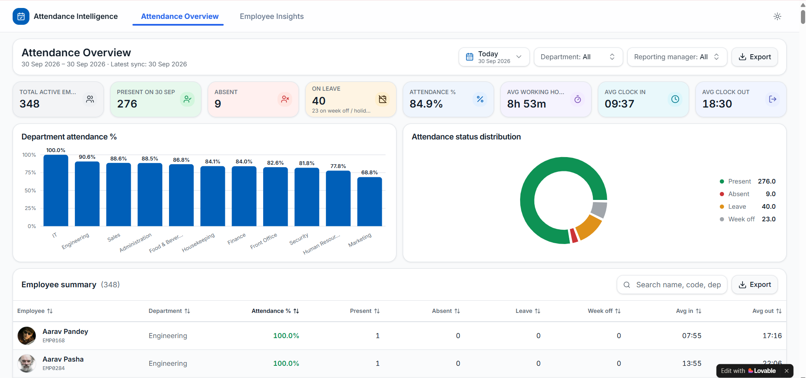

<div align="center">


# Workforce Attendance Intelligence Dashboard

### Workforce Attendance Analytics & Insights

**Organization-level attendance reporting and individual employee insights, in one interactive dashboard.**

<br />


<br /><br />

<a href="#executive-overview">Overview</a> &nbsp;|&nbsp;
<a href="#business-challenge">Challenge</a> &nbsp;|&nbsp;
<a href="#dashboard-modules">Modules</a> &nbsp;|&nbsp;
<a href="#attendance-analytics-and-business-logic">Business Logic</a> &nbsp;|&nbsp;
<a href="#filters-and-reporting-experience">Filters</a> &nbsp;|&nbsp;
<a href="#my-role-and-contribution">My Role</a> &nbsp;|&nbsp;
<a href="#documentation">Documentation</a>

<br /><br />

<a href="https://hr-attendance-dashboard.lovable.app">
  
</a>
&nbsp;
<a href="https://github.com/Nandini-Boda/Workforce-Attendance-Intelligence-Dashboard">
  
</a>

<sub>The live link opens the published dashboard experience as an interactive demonstration. This repository does not publish confidential employee or organizational information.</sub>

</div>

<!--
  SCREENSHOT PRIVACY REVIEW (action required before publishing images)
  The three files in Screenshots/ show employee names, employee codes and profile photos.
  Employee Insights.png also shows a date of birth, phone number and work email.
  They were NOT embedded. After confirming the data is fully synthetic, or after masking
  those fields, remove the comment markers around the image blocks marked
  "SCREENSHOT:" in this file.

  Hero image (place under the buttons above):
  <div align="center">
    
  </div>
-->

---

## Executive Overview

The **Workforce Attendance Intelligence Dashboard** gives HR teams, department managers, workforce operations and management stakeholders centralized visibility into attendance, punctuality, working hours and attendance patterns.

It combines two complementary views: **organization-level reporting** to see how departments and teams are performing, and **individual employee insights** to investigate attendance history in detail. Both share the same date and employee context, so a reviewer can move from a headline number to the people behind it.

| Audience | What they use it for |
| :-- | :-- |
| **HR teams** | Consolidated attendance reporting and employee-level attendance reviews |
| **Department managers** | Department and reporting-manager comparisons of attendance and punctuality |
| **Workforce operations** | Daily headcount status and working-hour patterns |
| **Management** | A concise view of attendance rate, trends and department performance |

---

## Business Challenge

Workforce attendance reporting commonly runs into challenges such as:

- **Fragmented attendance information** across sources and formats
- **Difficulty monitoring attendance** consistently across departments
- **Limited visibility into punctuality** such as late arrivals and early departures
- **Time-consuming reviews** of individual employee attendance
- **Unclear working-hour patterns**
- **A need for consolidated HR reporting**
- **Limited ability to investigate** an individual's attendance trend

---

## Dashboard Modules

<div align="center">

| Module 1: Attendance Overview | Module 2: Employee Insights |
| :-: | :-: |
| Route `/` | Route `/insights` |
| Organization-level reporting | Individual attendance investigation |

</div>

### Module 1: Attendance Overview

An organization-wide view of workforce attendance for the selected period.

| Capability | What it provides |
| :-- | :-- |
| **Headline KPIs** | Total active employees; present, absent and on-leave counts for the latest date; employees on week off; attendance rate; average working hours; average clock-in and clock-out times |
| **Department comparison** | Attendance percentage by department |
| **Status distribution** | Share of present, absent, leave and week-off statuses |
| **Multi-day trends** | Present, absent and leave patterns over the selected period |
| **Employee summary directory** | Department, reporting manager, attendance rate, attendance counts and average working hours; selecting an employee opens their Employee Insights view |
| **Filtered export** | CSV export of the filtered workforce summary |

<!--
  SCREENSHOT: Attendance Overview (uncomment after privacy review)
  
  <sub>Attendance Overview: KPIs, department attendance and status distribution</sub>

  SCREENSHOT: Employee summary (uncomment after privacy review)
  
  <sub>Employee summary directory with sortable attendance columns and search</sub>
-->

### Module 2: Employee Insights

A detailed attendance view for one selected employee.

| Capability | What it provides |
| :-- | :-- |
| **Employee selection** | Searchable selector that keeps the chosen reporting period when switching employees |
| **Profile summary** | Designation, department, location, reporting manager and joining information |
| **Current-date status** | Attendance status for the current date (Indian Standard Time), based on available attendance data |
| **Individual KPIs** | Days present and absent, approved leave days, half days, week-off days, late arrivals, early departures, average working hours, average clock-in and clock-out times |
| **Monthly calendar** | Color-coded daily statuses: present, half day, leave, absent, week off or holiday |
| **Attendance history** | Chronological daily records with status, leave type, clock-in and clock-out, working hours and punctuality indicators, with text search |

<!--
  SCREENSHOT: Employee Insights (uncomment after privacy review; contains personal fields)
  
  <sub>Employee Insights: profile, individual KPIs, monthly calendar and daily history</sub>
-->

---

## Attendance Analytics and Business Logic

The dashboard turns raw attendance records into consistent, comparable measures.

**Status classification.** Each record is grouped into one of six categories: Present, Half Day, Leave, Absent, Week Off / Holiday, or Other (anything that does not match a defined category).

| Status | Present credit | Leave credit | Absent credit | In attendance rate? |
| :-- | :-: | :-: | :-: | :-: |
| Present | 1 | 0 | 0 | Yes |
| Half Day | 0.5 | 0.5 | 0 | Yes |
| Leave | 0 | 1 | 0 | Yes |
| Absent | 0 | 0 | 1 | Yes |
| Week Off / Holiday | 0 | 0 | 0 | **No, excluded** |

**Attendance rate**

```text
Attendance Rate (%) = Present Credits / (Present Credits + Absent Credits + Leave Credits) x 100
```

Week-offs and holidays are excluded so scheduled non-working days do not lower the rate.

**Working hours.** Durations are normalized to minutes and shown as hours and minutes (for example, 495 minutes appears as 8h 15m). Averages use only records with positive working-hour values.

**Punctuality.** Late arrivals, early departures and clock-in / clock-out times are tracked per employee.

**Date presets.** Presets are anchored to the **latest available attendance date** in the data, not the calendar date. Data is brought in through scheduled synchronization; the dashboard is not a real-time or streaming view.

> These figures support reporting and review. They are not a substitute for HR policy decisions or payroll calculations.

---

## Filters and Reporting Experience

| Control | Purpose |
| :-- | :-- |
| **Date presets** | Quick periods anchored to the latest available attendance date |
| **Custom date ranges** | Any specific period of interest |
| **Department selection** | Compare or focus on one or more departments |
| **Reporting-manager selection** | Review attendance by team lead |
| **Employee selection** | Switch to an individual's attendance record |
| **Filter-preserving navigation** | Date and employee selections carry between modules |
| **CSV export** | Download the filtered workforce summary |

These controls let users start with the organization-wide picture, narrow to a department or manager, and then open an individual employee's attendance history without losing context.

---

## Business Value

- **Better workforce attendance visibility** in a single place
- **More structured HR reporting** built on consistent status rules
- **Faster attendance reviews** through shared filters and drill-down
- **Clearer department-level comparisons**
- **Better visibility into punctuality patterns**
- **Easier employee-level investigation** of attendance history
- **More informed management discussions** backed by consistent metrics

---

## Technology Stack

| Technology | Purpose in this project |
| :-- | :-- |
| **Google BigQuery** | Reporting data source for attendance data |
| **Lovable** | Platform used to build and publish the dashboard |
| **TanStack Start, Router and Query** | Application framework, page routing and data retrieval |
| **React with Shadcn UI and Radix UI** | Interface components |
| **Tailwind CSS** | Styling and responsive layout |
| **Recharts** | Charts and visualizations |
| **date-fns** | Date handling |

---

## My Role and Contribution

This is a **collaborative dashboard development project**. My involvement focused on:

- Understanding workforce attendance reporting requirements
- Organizing attendance information into clear dashboard modules
- Structuring attendance KPIs and business metrics
- Supporting dashboard design and reporting usability
- Reviewing attendance classifications and calculation logic
- Validating dashboard reporting views

---

## Access and Responsive Design

The dashboard layout is responsive across desktop, tablet and mobile screens. The live link provides access to the published dashboard experience only; it does not provide access to confidential employee information.

---

## Documentation

| Document | Description |
| :-- | :-- |
| [Project Overview](docs/project-overview.md) | Purpose, audience and key features |
| [Dashboard Modules](docs/dashboard-modules.md) | Modules, KPIs, filters and navigation |
| [Attendance Metrics](docs/attendance-metrics.md) | Status classification and calculation logic |
| [Data Architecture](docs/data-architecture.md) | How the data and reporting layers fit together |

---

## Data Privacy and Demonstration Note

This public portfolio presentation does not expose confidential employee or organizational information. Cloud project, dataset and table identifiers, connection details and credentials are intentionally not published, and no employee personal details are listed in this README.

---

<div align="center">

**Workforce Attendance Intelligence Dashboard**

<sub>A workforce analytics business intelligence case study: collaborative dashboard development.</sub>

</div>
